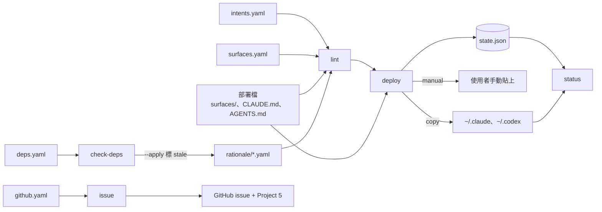

# Architecture

ai-dev-tools 管理 Claude 與 ChatGPT/Codex 的協作規範。這份文件描述 repo 現在的資料流、元件與資料夾配置；設計理由寫在各張 ADR。

## 概觀

規則從一份平台中立的 intent 清單（`intents.yaml`）出發。每個 surface，也就是一個 instruction 的載入位置（例如 `~/.claude/CLAUDE.md`、claude.ai preferences），都有一份手寫的部署檔，措辭針對該平台調整，不從共用來源組裝（ADR-0001）。每個 intent 在每個適用的 surface 都必須有一筆 rationale 紀錄。紀錄逐字引用部署檔中的規則原文，並記下狀態、觀察和 evidence（ADR-0002）。狀態只代表規則驗證到什麼程度，不會擋住部署（ADR-0003）。

資料流是單向的：`intents.yaml` → `surfaces/` 部署檔 ↔ `rationale/` 紀錄 → `lint` 檢查一致性 → `deploy` 依 surface 的 channel 處理。channel 有幾種：

- **copy**：複製到家目錄，部署紀錄存在 repo 外的 state 檔，之後用來偵測 drift（ADR-0004）。
- **manual**：印出全文，由使用者手動貼上後再確認。
- **in-repo**：repo 內的實體檔，不需要部署。

決策與已核准的 plan 會同步成 GitHub issue，並加入 Project（ADR-0005）。ADR 本身用 Nodit 卡片格式管理（ADR-006）。

## 主要元件



| 元件 | 職責 | 相關卡片 |
|---|---|---|
| `scripts/lib/lint.ts` | 檢查每個適用的 intent 在每個 surface 都有紀錄、`text` 逐字出現在部署檔、部署檔每個段落都被引用、狀態約束與長度上限 | ADR-0001、ADR-0002、ADR-0003 |
| `scripts/lib/blocks.ts` | 把部署檔切成規則段落（略過標題、HTML 註解，程式碼區塊整塊保留），供 lint 比對引用 | ADR-0002 |
| `scripts/lib/deploy.ts` | 依 channel 部署；拒絕 lint 失敗、空檔、未 commit 和 symlink 目標；遇到 drift 時要求 `--pull` 或 `--overwrite`，覆蓋前先備份 | ADR-0004 |
| `scripts/lib/status.ts` | 比對 state 紀錄、repo 部署檔與目標檔，列出未部署變更、drift 與手動目標的確認狀態 | ADR-0004 |
| `scripts/lib/env-checks.ts` | 檢查會讓部署失效的本機設定，例如 `AGENTS.override.md` | ADR-0004 |
| `scripts/lib/check-deps.ts` | 比對規則依賴的 skill 已安裝版本與 upstream，`--apply` 把受影響的紀錄改成 `stale` | ADR-0003 |
| `scripts/lib/issue.ts` | 以 marker 去重，建立 decision／task issue 並加入 Project；用 lock 防止重複執行，並記錄 key 到 issue 的對應 | ADR-0005、ADR-006 |
| `scripts/lib/context.ts` | 共用的路徑展開、雜湊、git 查詢、state 檔讀寫與原子寫入 | — |

## 專案結構

```nodit-tree
intents.yaml              平台中立的 intent 清單，不部署，ADR-0001
surfaces.yaml             surface 清單：channel、目標路徑、model、長度上限與來源
surfaces/                 global surface 的部署檔
  claude-ai/              claude.ai preferences（manual）
  claude-code/            ~/.claude/CLAUDE.md（copy）
  codex/                  ~/.codex/AGENTS.md，與 ChatGPT 雙向同步（copy）
CLAUDE.md                 本 repo 給 Claude Code 的部署檔（claude-code-repo）
AGENTS.md                 本 repo 給 Codex 的部署檔（codex-repo）
rationale/                每個 surface 一份紀錄：逐字原文、狀態、觀察與 evidence，ADR-0002
deps.yaml                 規則依賴的 skill、upstream 與安裝路徑
github.yaml               issue 同步的目標 repo、Project 與 label，ADR-0005
scripts/                  npm scripts 的進入點：lint、deploy、status、check-deps、issue
  lib/                    各指令的實作與測試
docs/
  decisions/              ADR 卡片（Nodit 格式），ADR-006
  records/                非 ADR 的決策紀錄：grill 決策集、codex-global 缺口分流
  spikes/                 平台載入行為的查核與實驗結果
  audits/                 prompt 稽核報告
  ARCHITECTURE.md         本文件
nodit.config.json         Nodit 設定與 managed block 的 hash
.claude/skills/           Nodit 卡片與架構文件的 Claude Code skills
```

## 相關決策

- ADR-0001：intent 清單平台中立；每個 surface 各有一份手寫部署檔，不靠 build 組裝。
- ADR-0002：rationale 逐字引用部署檔中的規則，並以狀態約束 evidence 的要求。
- ADR-0003：eval 只決定狀態標籤，不阻擋部署；新規則一律從 `experimental` 開始。
- ADR-0004：global surface 以 copy 部署，靠 state 雜湊偵測 drift。
- ADR-0005：ADR 定案和 plan 核准時，同步成 GitHub issue 與 Project 項目。
- ADR-006：ADR 改用 Nodit 卡片格式，Nodit managed block 是檔案分離規則的例外。
